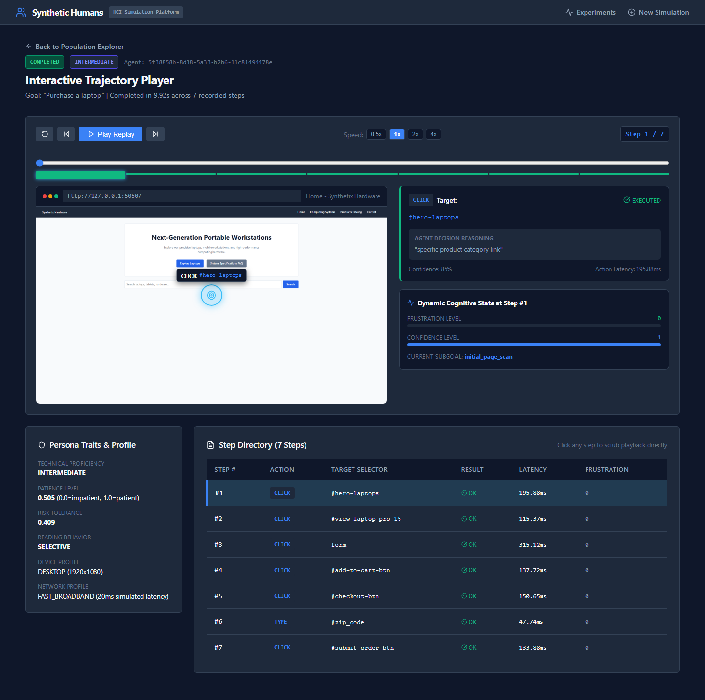
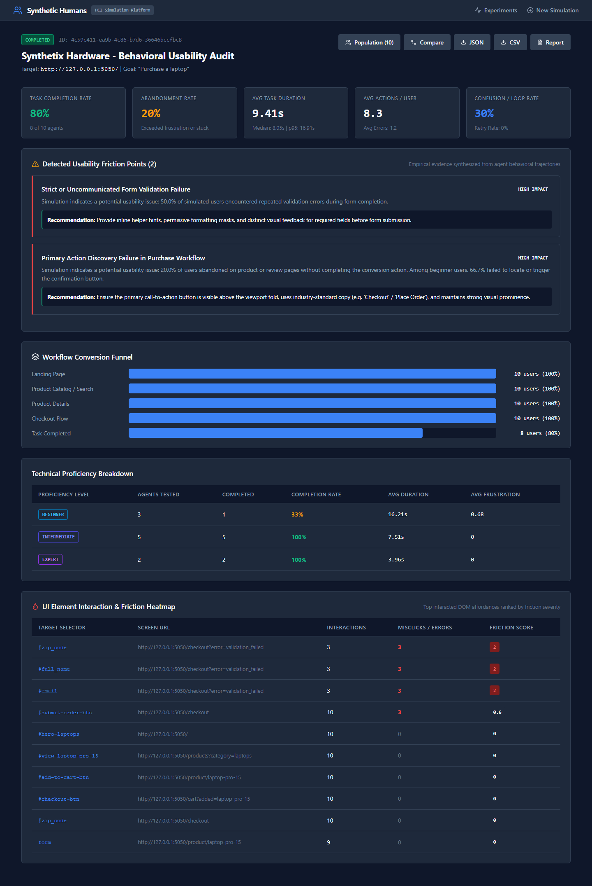
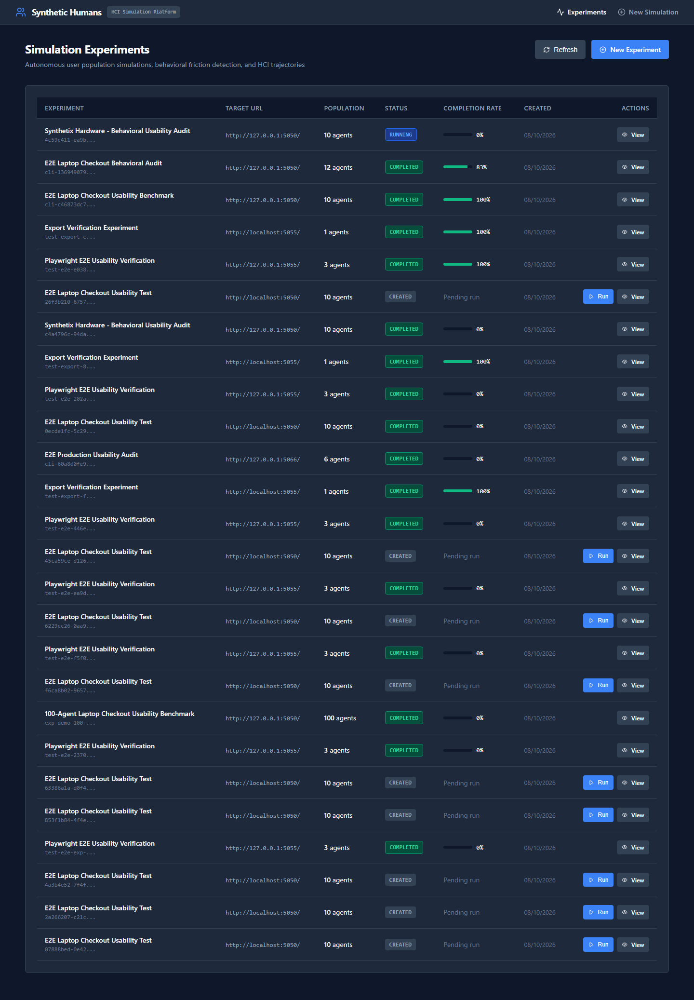
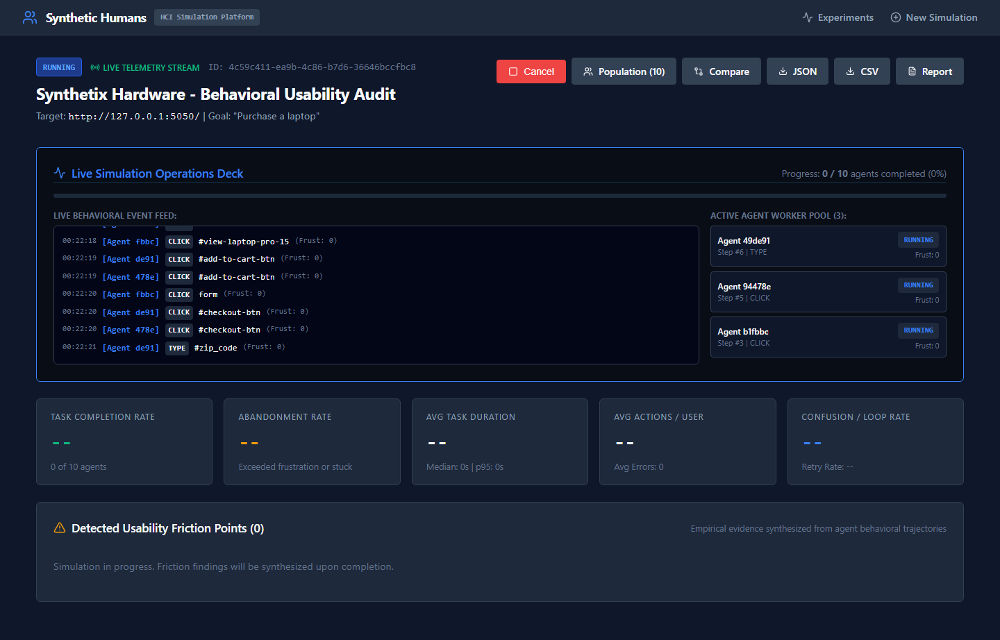
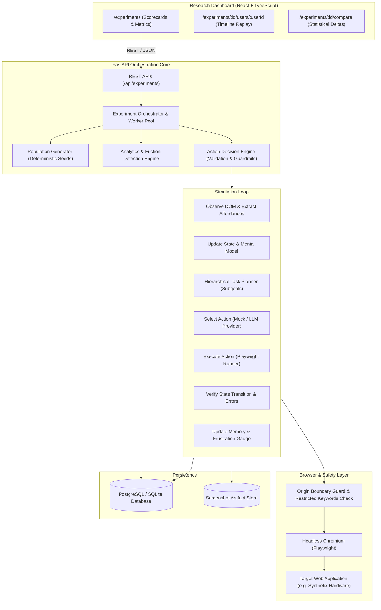

# Synthetic Humans

> **Behavioral user-simulation and software-testing platform**: Deploy populations of persistent synthetic users across real web applications through headless Playwright browsers to measure task completion, identify confusing UI elements, detect navigation loops, and discover workflow friction.

---

## 1. What Synthetic Humans Does

**Synthetic Humans** is an automated HCI (Human-Computer Interaction) simulation system. Instead of generating static textual feedback from an LLM prompt, Synthetic Humans instantiates populations of structured synthetic users that interact with live web applications via real browser automation.

The platform continuously answers:
* **Where do users abandon the application?** (Drop-off hotspots and frustration triggers)
* **Which UI elements cause confusion?** (Misclicks, unclickable affordances, cryptic validation errors)
* **Which user populations struggle?** (Disparities between Beginner, Intermediate, and Expert cohorts)
* **How long does each task take?** (Duration distribution, median, and p95 timings)
* **How does a UI change affect task completion?** (Differential side-by-side experiment comparisons)

---

## Visual Showcase

| Interactive Trajectory Player | Live Usability Analytics |
|:---:|:---:|
|  |  |

| Experiment Registry Dashboard | Live Telemetry HUD |
|:---:|:---:|
|  |  |

---

## 2. Why Synthetic Humans Are Different from LLM Personas

Traditional "persona testing" relies on one-shot prompts where an LLM is asked to roleplay an opinion about a screenshot or HTML snippet. This produces superficial, non-reproducible text opinions detached from real user behavior.

In **Synthetic Humans**:
1. **Persistent State & Memory**: Synthetic users maintain working memory of recently attempted actions, visited paths, discovered elements, and past failures throughout the session.
2. **Cognitive & Affective State Machine**: Every action directly modifies the user's **frustration level** and **confidence level**. Consecutive errors or unhelpful navigation increase frustration; progress relieves it.
3. **Behavioral Policies**: Trait parameters (Patience, Technical Proficiency, Risk Tolerance, Reading Behavior) dictate interaction velocity, attention to helper text, hesitation before submission, and abandonment thresholds.
4. **Real DOM & Browser Execution**: Simulated agents run inside Playwright browser instances, clicking buttons, typing into forms, waiting for DOM transitions, and encountering real timeouts, network delays, and layout shifts.
5. **No Blind Execution**: The agent never assumes an action succeeded. Every interaction follows a strict **Observe → Update State → Formulate Intent → Decide → Act → Verify Result → Update Memory** loop.

---

## 3. Architecture



---

## 4. Data Model

The data layer uses normalized tables with explicit columns for high-query data:

* **`experiments`**: Tracks experiment configuration, population size, structured task conditions, random seeds, allowed origins, and lifecycle status (`CREATED`, `RUNNING`, `COMPLETED`, `FAILED`, `CANCELLED`).
* **`synthetic_users`**: Stores persistent user attributes: demographic traits, technical proficiency (`BEGINNER`, `INTERMEDIATE`, `EXPERT`), patience (0.0–1.0), risk tolerance, reading behavior, device profile (viewport/agent), network profile, frustration level, and confidence level.
* **`trajectories`**: Records every step in the agent's interaction timeline: timestamp, URL, visible text summary, action type (`CLICK`, `TYPE`, `SELECT`, `SCROLL`, `PRESS_KEY`, `GO_BACK`, `WAIT`, `ABANDON`), target selector, decision reasoning, action confidence, action result (`SUCCESS`, `FAILED`, `NOOP`), latency (ms), and screenshot reference.
* **`experiment_metrics`**: Aggregates quantitative population statistics: task completion rate, abandonment rate, average/median/p95 duration, retry rate, confusion rate, and breakdowns by technical proficiency and device.
* **`friction_findings`**: Synthesizes evidence-based usability findings with severity ratings (`HIGH`, `MEDIUM`, `LOW`), affected user percentages, and actionable recommendations.
* **`experiment_comparisons`**: Stores differential metrics between baseline and variant application versions.

---

## 5. The Simulation Loop

Every synthetic user executes this loop at every interaction step:

```text
       ┌───────────────┐
       │ 1. OBSERVE    │  Extract interactive DOM affordances, page text, URL, and screenshot.
       └───────┬───────┘
               ▼
       ┌───────────────┐
       │ 2. STATE      │  Update visited pages, check for cyclical loops, update mental model.
       └───────┬───────┘
               ▼
       ┌───────────────┐
       │ 3. INTENT     │  Hierarchical Task Planner derives current subgoal from page context.
       └───────┬───────┘
               ▼
       ┌───────────────┐
       │ 4. DECIDE     │  Decision Engine selects action filtered through persona traits and memory.
       └───────┬───────┘
               ▼
       ┌───────────────┐
       │ 5. EXECUTE    │  Action Executor runs command via Playwright with timeout & safety traps.
       └───────┬───────┘
               ▼
       ┌───────────────┐
       │ 6. VERIFY     │  Compare resulting URL and DOM against expected state transition.
       └───────┬───────┘
               ▼
       ┌───────────────┐
       │ 7. MEMORY     │  Record outcome. Increase frustration if failed/NOOP; reduce if progress.
       └───────┬───────┘
               ▼
   [Continue or Terminate: Success / Abandonment / Timeout]
```

---

## 6. Behavioral Differentiation

Synthetic users do not follow uniform trajectories:
* **Beginner**: Reads more helper and banner text, makes navigational detours, hesitates on obscure fields, accumulates frustration quickly when cryptic errors occur, and exhibits lower discovery rates for unannounced controls.
* **Expert**: Rapidly scans headings, navigates directly via search bars or primary calls-to-action, bypasses informational FAQs, but abandons early if workflows are excessively slow or broken.
* **Impatient (Low Patience)**: Skips instructions, clicks prominent targets immediately, and triggers abandonment quickly if forward progress stalls.
* **Risk-Averse**: Hesitates on irreversible buttons, double-checks form inputs, and prefers back-navigation over exploratory actions.

---

## 7. Safety Boundaries & Ethical Constraints

Synthetic Humans is designed strictly for authorized software usability testing:
1. **Allowed Origins Whitelist**: Before starting, target URLs are validated against configured `allowed_origins`. Any attempt to redirect or navigate outside the whitelist triggers an immediate security interception.
2. **Explicit Owner Authorization**: Experiment creators must explicitly certify authorization before an experiment can be initialized.
3. **Restricted Actions**: Real credit card submissions, account deletions, password changes, credential exfiltration, arbitrary file access, and arbitrary shell commands are strictly blocked.
4. **No Automated CAPTCHA / Auth Bypassing**: The system does not circumvent security controls.

---

## 8. Toy Target Application

The repository includes a locally hosted, intentionally flawed target application located at `tests/fixtures/demo_app/server.py` (**Synthetix Hardware**):
* **Flaw 1 (Cryptic Form Validation)**: The checkout postal code field strictly enforces a 5-digit numeric format but responds with a vague `"Validation Check 4B Failed"` message without format hints.
* **Flaw 2 (Hidden / Unclear Primary Action)**: The cart checkout button is labeled `"Review & Finalize Inquiry"` rather than `"Proceed to Checkout"` and placed below extended notices requiring scrolling on compact viewports.
* **Flaw 3 (Navigation Loop)**: The category menu directs users to an intermediate architecture index that loops back to the homepage overview.

---

## 9. Quickstart & Local Execution

### Prerequisites
* Python 3.12+
* Node.js v20+ and npm
* (Optional) Docker & Docker Compose

### 1. Install Dependencies
```bash
# Backend virtual environment & Playwright browser
python -m venv venv
.\venv\Scripts\Activate.ps1   # On Windows (or source venv/bin/activate on Linux/macOS)
pip install -r backend/requirements.txt
playwright install chromium

# Frontend dependencies
cd frontend && npm install && cd ..
```

### 2. Run Automated Test Suite
```bash
# Runs unit tests, integration tests, and Playwright end-to-end simulation
pytest tests/ -v
```

### 3. Run the 100-User Demonstration Experiment
The demonstration script starts the local demo application, initializes the database, generates 100 synthetic users, simulates their browser interactions, computes metrics, and prints discovered usability flaws:
```bash
python -m tests.run_demo_experiment
```

### 4. Headless CLI Runner & CI/CD Usability Regression Gate
Run automated usability experiments directly from your terminal or CI/CD pipelines (e.g. GitHub Actions):

```bash
# Run 10 synthetic agents, assert completion rate >= 70%, and export audit report
python scripts/synthetic_cli.py \
  --url http://127.0.0.1:5050/ \
  --population 10 \
  --goal "Purchase a laptop" \
  --threshold 0.70 \
  --export-report usability-audit.md \
  --export-json results.json
```
If the actual completion rate falls below `--threshold`, the CLI exits with non-zero code `1`, immediately catching usability regressions in automated test pipelines before release.

### 5. Run Full Stack Locally
```bash
# Terminal 1: Toy Target Application (Port 5050)
python -m uvicorn tests.fixtures.demo_app.server:app --port 5050

# Terminal 2: Synthetic Humans Backend (Port 8000)
python -m uvicorn backend.app.main:app --port 8000 --reload

# Terminal 3: Research Dashboard (Port 3000)
cd frontend && npm run dev
```

Open **`http://localhost:3000`** in your browser to explore the dashboard.

---

## 10. End-to-End Capabilities

* **Interactive Trajectory Replay Player**: Video-style playback scrubber (`Play`, `Pause`, `0.5x–4x` speed, next/prev step) featuring an interactive visual canvas overlay that projects animated pulsing target rings directly onto page screenshots where simulated users clicked or struggled.
* **Real-Time Simulation Streaming Deck**: Server-Sent Events (SSE) telemetry stream on `GET /api/experiments/{id}/stream`. Connects the dashboard to a live HUD displaying active agents clicking, typing, and navigating in real time.
* **One-Click Data Exports**:
  - **JSON**: Full hierarchical export of experiment parameters, synthetic population profiles, all trajectory steps, and findings (`GET /api/experiments/{id}/export/json`).
  - **CSV**: Granular event log with timestamps, selectors, latencies, and error codes (`GET /api/experiments/{id}/export/csv`).
  - **Markdown Usability Audit Report**: Formatted executive summary with scorecards, findings, and UX recommendations (`GET /api/experiments/{id}/export/report`).

---

## 11. Configuring External LLM Providers

Synthetic Humans includes a deterministic **Mock Provider** enabled by default so the entire suite runs offline with zero API costs and 100% reproducibility.

To enable external providers:
1. In `.env`:
   ```env
   DEFAULT_LLM_PROVIDER=openai
   OPENAI_API_KEY=sk-...
   OPENAI_MODEL=gpt-4o-mini

   # Or Gemini
   # DEFAULT_LLM_PROVIDER=gemini
   # GEMINI_API_KEY=AIza...
   # GEMINI_MODEL=gemini-2.0-flash
   ```
2. When creating an experiment via API, CLI, or UI, specify `model_configuration: {"provider": "openai", "model_name": "gpt-4o-mini"}`. The engine uses strict JSON schemas, exponential backoff retries, and graceful fallbacks.

---

## 12. Interpreting Simulation Results

* **Completion & Abandonment Rates**: Quantitative indicators of workflow friction. Low completion among beginners signals a discovery or guidance barrier.
* **Evidence-Based Language**: Findings are framed as empirical observations (e.g., *"Simulation indicates a potential usability issue: 38% of beginner users failed to discover the checkout button"*), not dogmatic assertions.
* **Simulation Projections vs Real User Studies**: Simulated agents operate under modeled heuristics. Findings pinpoint friction candidates to prioritize during human user testing.

---

## 13. Known Limitations

* **Web Applications Only**: Desktop, native mobile, and physical-world applications are not supported in the MVP.
* **Canvas / WebGL / Dynamic Drawing**: Interactions with non-standard `<canvas>` controls or complex drag-and-drop are limited in this version.
* **Complex Multi-Tab / OAuth Workflows**: Multi-origin single sign-on flows require explicitly whitelisting all identity provider domains in `allowed_origins`.
